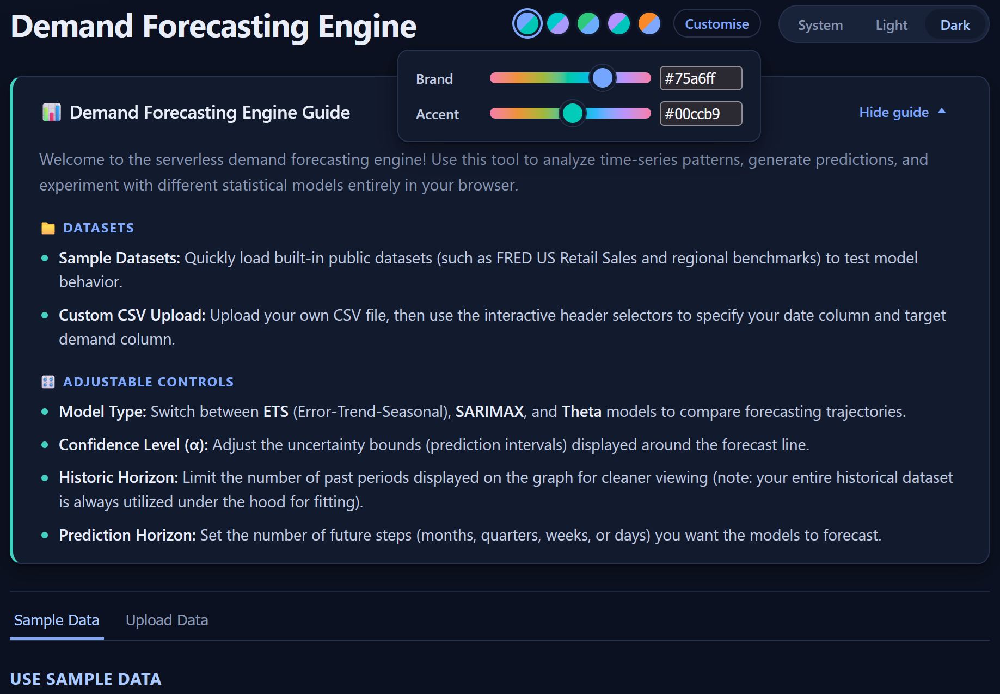
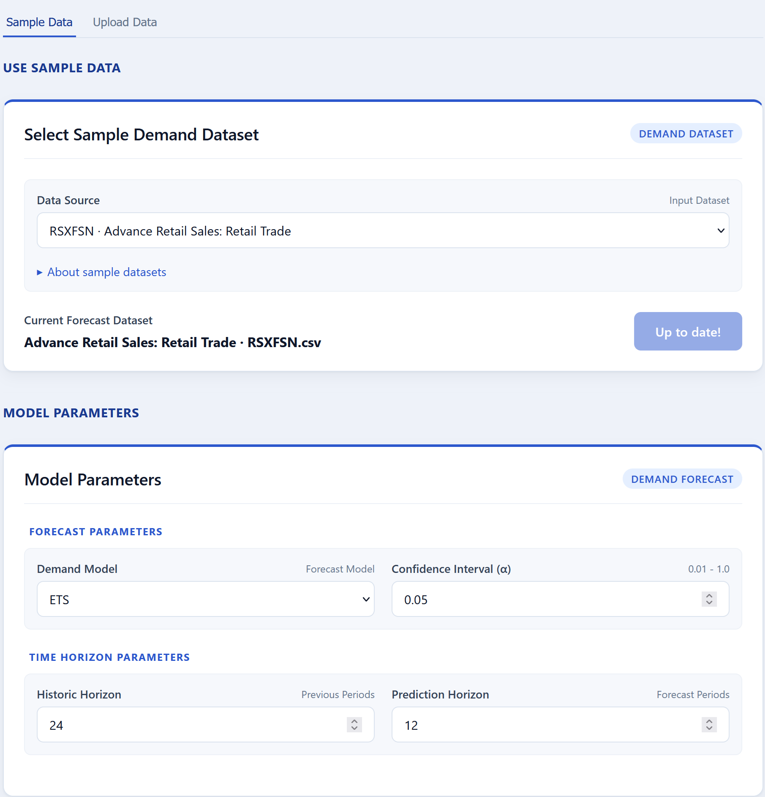
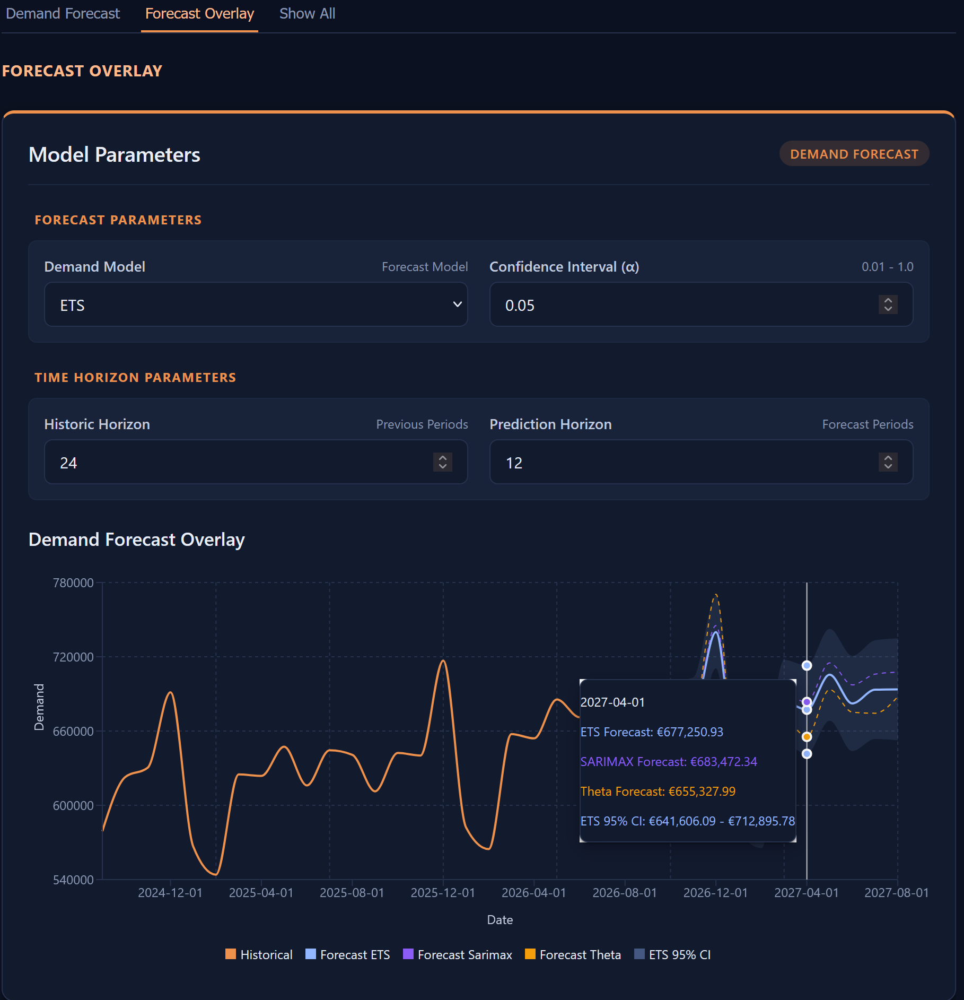

# Demand Forecasting Engine

An interactive, client-side web app for exploring and forecasting demand patterns in time-series data. Python models (`pandas`, `statsmodels`) run directly in the browser through WebAssembly (Pyodide), so there is no backend to host and uploaded data never leaves the user's machine.

**[Live demo](https://christopherdgibson.github.io/demand-forecasting-engine/)**

## Background

This project sits at the intersection of quantitative economics and modern frontend development. Moving time-series forecasting out of backend servers and into the browser shows how WebAssembly can connect data-science tools to responsive user interfaces, and keeps user data on the user's machine.

## Features

- **In-browser Python:** CPython, `pandas` and `statsmodels` run in WebAssembly via Pyodide, with no server or backend API workers.
- **Multiple models:** Compare Exponential Smoothing (ETS), SARIMAX, and Theta forecasts.
- **Resilient fitting:** Each model is fitted independently. If one cannot be fitted to a dataset it is marked unavailable and the others still display. A run fails with a clear message only when no models can be fitted.
- **Confidence intervals:** Adjustable confidence level (α) with prediction bands on the chart.
- **Your own data:** Upload a CSV and map its date and demand columns with an interactive header selector, or start from built-in public datasets (e.g. FRED US Retail Sales, `RSXFSN`). Comma, semicolon, and tab delimiters are detected automatically.
- **Multi-periodicity:** Annual, quarterly, monthly, weekly and daily data. Transaction-level rows are summed into periods (periods with no rows count as zero demand), and seasonal periods are chosen automatically. Annual data uses non-seasonal models.
- **Data notes:** An incomplete first or last period is flagged in an informational note instead of silently skewing the forecast.
- **Model comparison metrics:** AIC, BIC, MAPE and RMSE for every fitted model in one table, with the best error values marked and a built-in glossary. See [Reading the metrics](#reading-the-metrics).
- **Horizon controls:** Independent controls for quantity of historical periods or forecast predictions to be displayed. The display horizon does not change the dataset used to fit the models, and changing the prediction horizon updates the forecast without refitting.
- **Clear error handling:** Python validation and convergence errors surface as a concise message in a dialog, with the full traceback available under "Show details".
- **Adaptive theming:** Light, dark, or system-following themes, brand colour presets, and custom brand and accent colours entered as hex codes or chosen with hue sliders. A hex code is approximated by its hue, with lightness fixed per theme so contrast stays consistent. Chart series colours are derived from the same hues and kept a minimum hue distance apart so lines stay distinguishable however the colours are changed. Preferences persist between visits.
- **Accessible UI:** Native radio inputs for theme and colour choices, `aria-expanded` disclosures, a captioned metrics table with row and column headers, Escape-to-close and focus handling in dialogs, series that differ by line pattern as well as colour, and reduced-motion support.

## Sample Datasets

Built-in series from the U.S. Census Bureau, via FRED. All are not seasonally adjusted, so the models learn the seasonal pattern themselves.

| Series | Description | Frequency | Units |
| --- | --- | --- | --- |
| `RSXFSN` | Advance Retail Sales: Retail Trade | Monthly | Millions of dollars |
| `RSAFSNA` | Advance Retail Sales: Retail Trade and Food Services | Monthly | Millions of dollars |
| `ECOMPCTNSA` | E-Commerce Retail Sales as a Percent of Total Sales | Quarterly | Percent |

## Screenshots





## Architecture

Unlike a typical full-stack app that puts Python behind FastAPI or Flask, this project runs Python in the browser. In addition to facilitating online demonstration, this minimises technical requirements while keeping data securely on the user's local machine.

1. **Pyodide bootstrap (`usePyodide`):** Loads the Pyodide runtime and the `numpy`, `pandas` and `statsmodels` packages, then writes the Python source files into Pyodide's virtual file system (`MEMFS`).
2. **Python pipeline:** Parses dates, sorts, maps columns to a standard schema, and resamples to the chosen frequency (`resample(freq).sum()`, so empty periods count as zero demand). It checks the first and last periods for incompleteness, then fits each model independently with the matching seasonal period. A `DatetimeIndex` is kept throughout so `statsmodels` can interpret time intervals, and dates become strings only at the JSON boundary. A fit returns the history, per-model metrics, per-model failures and dataset notes.
3. **Typed JS/Python bridge (`callPyFunction`):** A single generic function calls a named Python function, converts the result with `toJs`, and destroys the WASM proxies and runs `gc.collect()` afterwards to keep memory use low. Python code simply raises exceptions; the bridge catches them, extracts the exception type and message, and returns `{ success: false, type, message, trace }`, so callers can handle failure explicitly.
4. **State model:** Edits to the dataset live in a draft state and are applied by *Run Forecast*, which copies them into the "fitted" state once both the fit and the forecast succeed. Whether results are out of date is derived by comparing the two, and chart data, metrics, and the visible model are derived from the stored results rather than kept as separate state. Model failures are keyed by model, while dataset caveats travel separately as notes, so a note never marks a model as unavailable.
5. **Chart adapter:** Historical, forecast, and confidence-interval series from every available model are merged by date into one dataset for Recharts. Each model has its own colour and line pattern, with a custom tooltip and legend ordering.
6. **Theme layer:** Design tokens are CSS variables derived from two OKLCH hue values, with lightness set per theme. Charts, tooltips and controls all read the same variables, and a small inline script in `index.html` applies the saved theme before first paint to avoid a flash. A custom colour entered as hex is reduced to its OKLCH hue, and the brand and accent hues are kept a minimum distance apart so chart series never collapse into near-identical colours.

## Reading the metrics

- **AIC / BIC:** Fit quality with a penalty for model complexity (BIC penalises more heavily). Lower is better. They are only strictly comparable between models of the same family, so the table does not mark a "best" AIC or BIC.
- **MAPE / RMSE:** In-sample, one-step-ahead errors. By default every model is scored after the same number of initialisation periods. SARIMAX differences the series, so its first fitted values are not real predictions and would otherwise inflate its errors. The table states how many periods were skipped, and a toggle allows inclusion of skipped periods in error calculations.
- **Theta:** Reports RMSE only, taken from its own fit, so it is left out of the best-value marking.

These are fit measures on the data the models were trained on, not a test of future accuracy.

## Tech Stack

- **Frontend:** React, TypeScript, Recharts, Vite
- **In-browser runtime:** Pyodide (WebAssembly)
- **Modelling:** `statsmodels` (ETS, SARIMAX, Theta), `pandas`, `numpy`
- **Data:** Built-in public datasets (St. Louis Fed FRED, e.g. US Retail Sales `RSXFSN`) and user-uploaded CSV files

## Status

- [x] Pyodide WASM integration with Vite and React
- [x] CSV ingestion into the virtual file system (`MEMFS`)
- [x] Static deployment to GitHub Pages
- [x] Custom CSV upload with date and target column mapping
- [x] Multi-periodicity resampling and seasonal period mapping (annual to daily)
- [x] Multi-model selection (ETS, SARIMAX, Theta) with independent fitting
- [x] Confidence interval visualisation
- [x] Horizon controls (history and prediction)
- [x] Model comparison metrics table
- [x] Notes for incomplete first and last periods
- [x] Python error bridge with an error dialog
- [x] Light/dark themes with colour presets and custom hues
- [x] Custom brand and accent colours from hex codes, with hue-separated chart series

- [ ] Control for excluding incomplete periods (supported in the Python layer, not yet exposed in the UI)
- [ ] Out-of-sample backtesting
- [ ] Run Pyodide in a Web Worker so fitting does not block the UI thread

## Known Limitations

- SARIMAX uses a fixed order, (1,1,1)(1,1,1)ₛ, rather than a search.
- Metrics are in-sample. There is no hold-out evaluation yet.
- Fitting runs on the main thread, so the page can pause briefly during a run.
- A series needs at least three periods after resampling.
- Custom hex colours are approximated by hue rather than reproduced exactly.

## Running Locally

### Prerequisites

- Node.js 20 or later
- npm (or yarn)

No Python installation is needed. Python runs in the browser.

### Install and run

```bash
git clone https://github.com/christopherdgibson/demand-forecasting-engine.git
cd demand-forecasting-engine
npm install
npm run dev
```

Open the local URL Vite prints (typically http://localhost:5173). Pyodide downloads the WebAssembly runtime and Python packages on first load, which takes a few seconds.

### Build

```bash
npm run build
npm run preview
```

## Deployment (GitHub Pages)

The app is fully static. When deploying under a repository path:

- Set `base` in `vite.config.js` to `'/demand-forecasting-engine/'`.
- Load the Python files relative to that base, for example
  `` fetch(`${import.meta.env.BASE_URL}python/environment.py`) ``, not `/python/environment.py`, which would point at the domain root.
